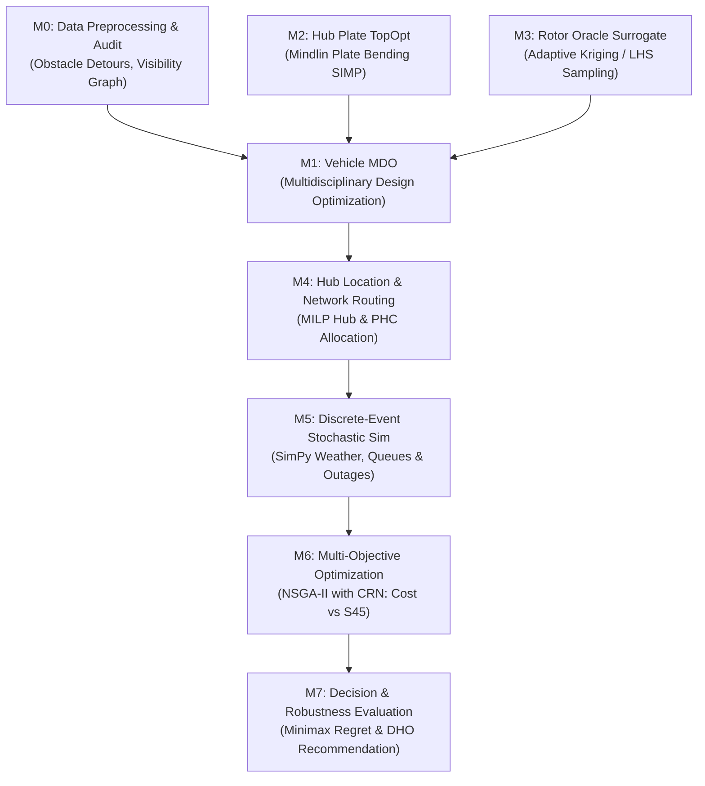

# AkashBhandan (SkyLink) — Medical Drone Delivery Network

[](https://github.com/YashShajil/AkashBhandan-SkyLink)
[](https://www.iitm.ac.in)
[](https://simpy.readthedocs.io/)

> **ED6002: Engineering Design Optimization — Final Project**  
> **Indian Institute of Technology Madras (November 2026)**  
> **Repository:** `AkashBhandan-SkyLink`  
> **Authors:** Yash ([@YashShajil](https://github.com/YashShajil)) & Priyanka

---

## 📌 Executive Summary & Problem Formulation

**AkashBhandan (SkyLink)** is an end-to-end multi-disciplinary design and optimization framework for an autonomous medical drone delivery network serving **Kaveripuram district** (approx. $60\text{ km} \times 45\text{ km}$).

The objective is to ensure that **critical emergency supplies (blood bags, antivenom, defibrillators) reach all 24 Primary Health Centers (PHCs) from candidate hospital hubs in under 45 minutes**, at the **minimum defensible annual total cost of ownership (TCO)**.

### Operational Context & Key Challenges
* **Candidate Hubs:** 7 hospital sites (District Hospital `H0` housing the district blood bank, Sub-district hospitals `H1`–`H6`, and PHC `P09` with spare land).
* **Delivery Classes:**
  1. *Emergency:* Blood, antivenom (critical deadline: $\le 45\text{ min}$; target payload $2.5\text{ kg}$).
  2. *Routine:* Vaccines, scheduled medicines (delivered within same calendar day).
  3. *Lab Samples:* Reverse logistics flown from remote PHCs back to testing hubs.
* **Geographical & Environmental Constraints:**
  * **No-Fly Zones:** 8 km radius circle around civil airstrip + reserved forest polygon (shortest obstacle-avoiding paths synthesized via visibility graphs).
  * **Stochastic Wind & Monsoons:** Hourly wind speeds and directional gusts that induce groundings or severe headwinds.
  * **Grid Outages:** Mandatory 3-hour scheduled power outages (Mon/Wed/Fri 14:00–17:00), constraining hub charging to backup generators ($2.7\text{ kW}$ capacity).
  * **Road Fallback:** Orders queued past timeout thresholds (30 min for emergency, 6 h for routine) automatically revert to ground ambulance at higher operational cost.

---

## 🏗️ Multi-Stage Optimization Architecture

The pipeline consists of eight interlinked modules ($M_0$ to $M_7$), ensuring mathematical rigor and cross-validation at each stage:



### Module Breakdown
1. **Module 0 — Data Audit & Spatial Preprocessing (`skylink/data.py`):**
   * Parses candidate sites, hourly demand profiles, and wind timeseries.
   * Resolves obstacle avoidance using a 64-gon circumscription and tangent visibility graph (maximum detour factor $2.04$).
   * Automatically validates data integrity against synthetic and real data packs.
2. **Module 1 — Multidisciplinary Vehicle Optimization (`skylink/m1_vehicle.py`):**
   * Optimizes rotor diameter $D$, battery capacity $E$, arm tube geometry $(d, t)$, and cruise speed $V$.
   * Solved via Multidisciplinary Feasible (MDF) with Sequential Least Squares Programming (SLSQP) and Individual Discipline Feasible (IDF) with `trust-constr`.
   * Analytic sensitivities validated against complex-step gradients ($\Delta = 10^{-20}i$) and finite differences.
3. **Module 2 — Hub Plate Topology Optimization (`skylink/m2_topopt.py`):**
   * Structural optimization of the central hub plate connecting drone arms.
   * Formulated as Mindlin-Reissner plate bending (avoiding shear locking via 1-point reduced shear integration and hourglass stabilization) under $2g$ vertical thrust.
   * Filtered SIMP density sweep with waterjet-ready thresholding.
4. **Module 3 — Figure-of-Merit (FM) Surrogate Modeling (`skylink/m3_surrogate.py`):**
   * Handles a scarce high-fidelity rotor CFD evaluation budget (maximum 30 points across 3 query batches).
   * Batch 1: 13-point Maximin Latin Hypercube + replicates. Batches 2–3: Adaptive Kriging standard error $\times$ Region of Interest (ROI) gradient acquisition.
5. **Module 4 — Network Hub Location & Fleet Sizing (`skylink/m4_network.py`):**
   * Disaggregated Mixed-Integer Linear Program (MILP) selecting active hub facilities and assigning PHCs.
   * Enforces 90th-percentile flyable wind headwind margins and peak-hour charging bay constraints.
6. **Module 5 — Stochastic Weather & Queueing Simulation (`skylink/m5_sim.py`):**
   * Hourly discrete-event simulator capturing stochastic order arrival bursts, dynamic battery charging/swapping, and scheduled power cuts.
   * Analytically cross-checked against theoretical $M/M/c$ queueing models and Erlang C equations.
7. **Module 6 — Multi-Objective Pareto Optimization (`skylink/m6_moo.py`):**
   * Multi-objective genetic algorithm (NSGA-II) using Common Random Numbers (CRN) across annual weather seeds.
   * Simultaneous trade-off between **Total Annualized Cost (₹)** and **Emergency 45-min Service Level ($S_{45}$)**.
8. **Module 7 — Multi-Criteria Decision Making & Robustness (`skylink/m7_decision.py`):**
   * Robustness sweeps across monsoon extremes, battery technology advancements (+20% energy density), and hardware price shifts (-30% drone capex).
   * Generates actionable policy briefs for the District Health Officer.

---

## 🎯 Recommended District System (DHO Brief)

| Metric | Typical Weather Week | Annual Average | Worst Monsoon Week |
| :--- | :---: | :---: | :---: |
| **Emergencies Delivered $\le$ 45 min ($S_{45}$)** | **98.0%** | **94.2%** | **~60.0%** |
| **Orders Reverting to Road Ambulance** | 1.0% – 2.0% | ~7.0% | Daytime Storm Windows |
| **Total Annualized System Cost** | **₹2.26 Crore / year** | — | — |

* **Selected Hubs (5):** SDH Nallur, SDH Vadakarai, SDH Melmalai (or District Hospital H0), SDH Kadalpuram, and PHC Arasampatti.
* **Fleet Configuration:** 15 drones (3 drones per hub), 7 charging pads, 14 spare battery modules.
* **Cost Composition:** ~33% operators (3 shifts, 24×7), ~33% drone hardware & battery life replenishment, ~15% hub pads/genset infrastructure, ~19% energy, battery degradation, and road trips.

---

## 📂 Repository Structure

```text
.
├── README.md                      # Project documentation and engineering guide
├── requirements.txt               # Python package dependencies
├── .gitignore                     # Git ignore rules for builds, caches, and IDEs
├── end_sem_ED6002_PROJECT.pdf     # Official project problem brief & guidelines
├── doe_template.csv               # Design of Experiments template for M3
├── doe_m3_22km_request1.csv       # Oracle LHS batch 1 request sample
├── oracle/                        # Oracle requests and responses
│   ├── request_1.csv
│   └── mock_demo/
├── Projectskylink_data/           # Cleaned district inputs & GIS geometries
│   ├── components.csv             # Drone component weight & cost catalog
│   ├── costs.yaml                 # Cost coefficients and utility tariffs
│   ├── demand.csv                 # Hourly delivery demand by class
│   ├── hourly_profile.csv         # Diurnal variation multipliers
│   ├── nofly.geojson              # Airspace boundary definitions
│   ├── sites.csv                  # Coordinates of H0-H6 and P01-P24
│   └── wind_days.csv              # Annual hourly wind velocity vectors
├── skylink_ED6002/
│   └── skylink/                   # Clean modular execution framework
│       ├── run_all.py             # Single execution orchestrator
│       ├── README.md              # Pipeline developer instructions
│       ├── data/                  # Real and reconstructed datasets
│       ├── docs/                  # Decision logs, DHO memos & formulation cards
│       ├── oracle/                # Active oracle batch exchange files
│       └── skylink/               # Core Python modules (m1..m7, data, sim)
├── [standalone scripts]           # (Pushed by collaborator: m1_standalone.py, etc.)
└── [output directories]           # (Pushed by collaborator: outputs/, tables, figs)
```

---

## 🚀 Getting Started

### 1. Prerequisites & Installation

Ensure you have **Python 3.10+** installed. Clone the repository and install required dependencies:

```bash
# Clone the repository
git clone https://github.com/YashShajil/AkashBhandan-SkyLink.git
cd AkashBhandan-SkyLink

# Create and activate a virtual environment (optional but recommended)
python3 -m venv .venv
source .venv/bin/activate  # On Windows: .venv\Scripts\activate

# Install required dependencies
pip install -r requirements.txt
```

### 2. Running the Complete Optimization Chain

Run all modules ($M_0 \rightarrow M_7$) from the modular runner:

```bash
cd skylink_ED6002/skylink

# Full run (~25 minutes on 2 cores)
python run_all.py

# Fast evaluation (reuses cached M2 TopOpt and M6 Pareto solutions)
python run_all.py --fast
```

---

## 🔬 Verification & Validation Index

Every module adheres to strict validation standards against independent analytical benchmarks:

| Module | Verification Check | Expected Benchmark / Agreement |
| :--- | :--- | :--- |
| **Data ($M_0$)** | Anomaly & boundary audit log | 0 unhandled gaps; shortest path triangle inequality verified |
| **Vehicle ($M_1$)** | MDA convergence & Complex-step gradient check | $\| \nabla_{\text{CS}} - \nabla_{\text{FD}} \| < 10^{-6}$; MDF and IDF agree to $< 10^{-9}$ |
| **Plate ($M_2$)** | MBB beam & Timoshenko deflection check | Stabilized Mindlin element matches beam bending within 2% |
| **Surrogate ($M_3$)** | Leave-One-Out Cross Validation (LOOCV) | $R^2 > 0.92$; Replicate error bounded by estimated nugget variance |
| **Network ($M_4$)** | Brute force vs. MILP verification | Branch-and-bound reaches zero LP gap; matches combinatorial enumeration |
| **Simulation ($M_5$)**| Discrete-event queue vs. theoretical $M/M/c$ | Queue length and waiting times match Erlang C formulation |
| **MOO ($M_6$)** | NSGA-II vs. Weighted-Sum GA check | Weighted sum points lie on the convex hull of the NSGA-II frontier |
| **Decision ($M_7$)** | Sensitivity & Minimax Regret evaluation | Robustness proven over 300 perturbed seasonal realizations |

---

## 👥 Collaboration & Contribution Guidelines

To contribute to this repository without sharing private security tokens or passwords:

1. **Repository Access:** The repository owner adds team members as **Collaborators** via `Settings` $\rightarrow$ `Collaborators` $\rightarrow$ `Add people`.
2. **Authentication:** Collaborators push using **their own** GitHub account credentials (SSH key, Personal Access Token, or Git Credential Manager).
3. **Branching Workflow:**
   ```bash
   # Create a feature branch
   git checkout -b feature/module-update
   
   # Stage and commit your changes
   git add <modified_files>
   git commit -m "Update standalone evaluation scripts and output figures"
   
   # Push your branch
   git push origin feature/module-update
   ```
4. Open a **Pull Request (PR)** on GitHub for review and integration into `main`.

---

## 📜 License & Acknowledgments

Developed as part of the **ED6002: Engineering Design Optimization** course at IIT Madras. All rights reserved.
